# ExamPro - Online Examination System

ExamPro is a MERN stack based online examination system developed as a full-stack project.

The main purpose of this project is to make the examination process easier for both students and administrators.

Students can create an account, log in, view available exams, attend examinations and check their results. Administrators can manage exams, questions and student details through the admin dashboard.

## Technologies Used

**Frontend**
- React.js
- Vite
- JavaScript
- HTML
- CSS
- Bootstrap

**Backend**
- Node.js
- Express.js
- MongoDB
- Mongoose
- JWT Authentication

**Tools**
- Visual Studio Code
- Git and GitHub
- Vercel
- Render

## Features

### Student Module
- Student registration and login
- Student dashboard
- View available examinations
- View examination instructions
- Attend online examinations
- Submit exam answers
- Check examination results

### Admin Module
- Admin login
- Admin dashboard
- Create and manage examinations
- Manage question bank
- Add, edit and manage questions
- Assign questions to examinations
- Manage student details
- View examination results

## Screenshots

### Student Side

**Home Page**

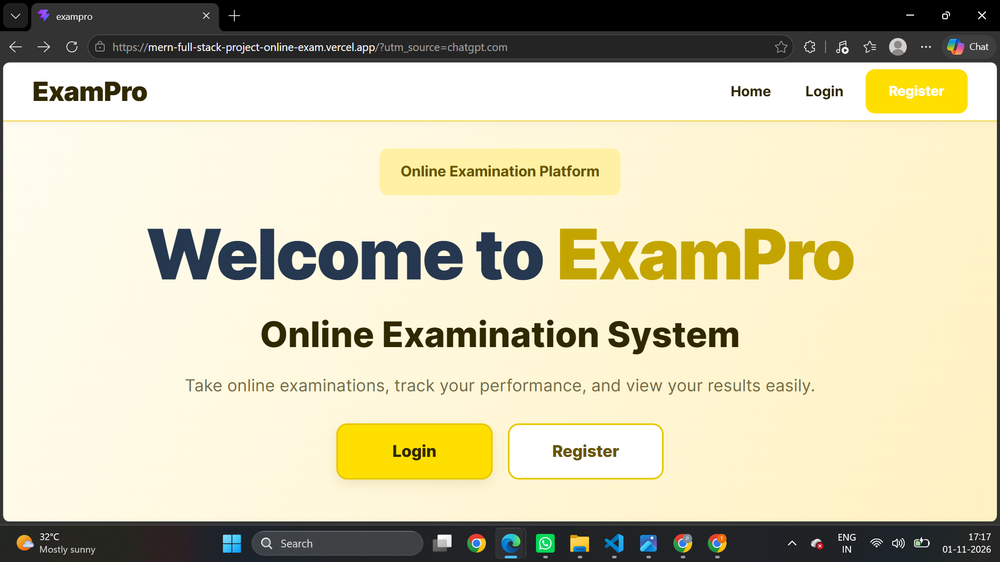

**Student Registration**

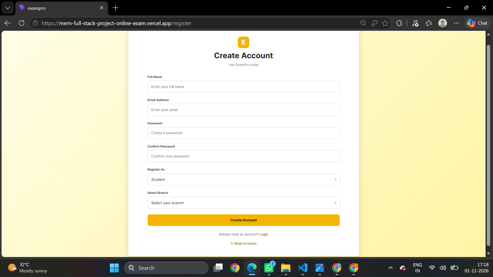

**Student Login**

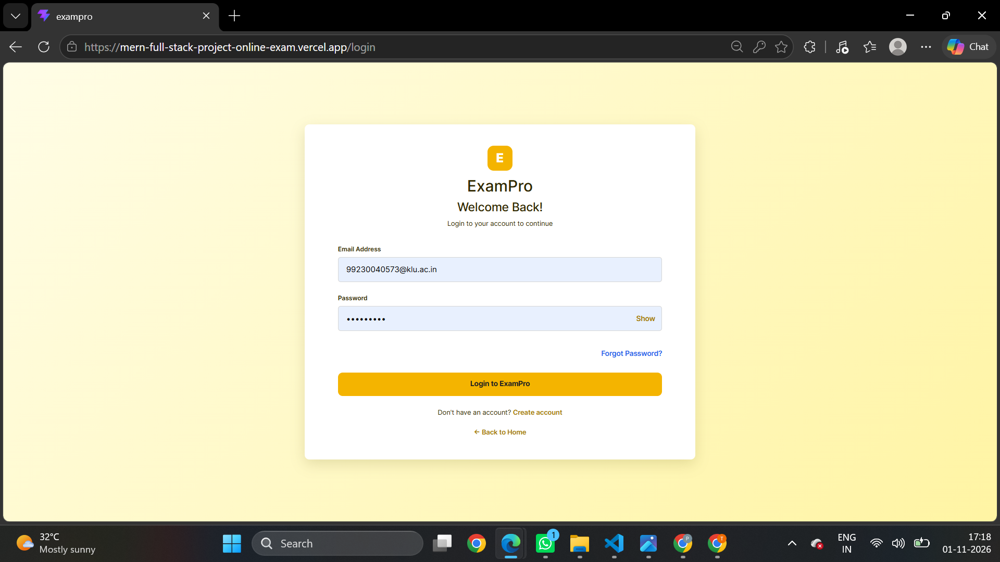

**Student Dashboard**

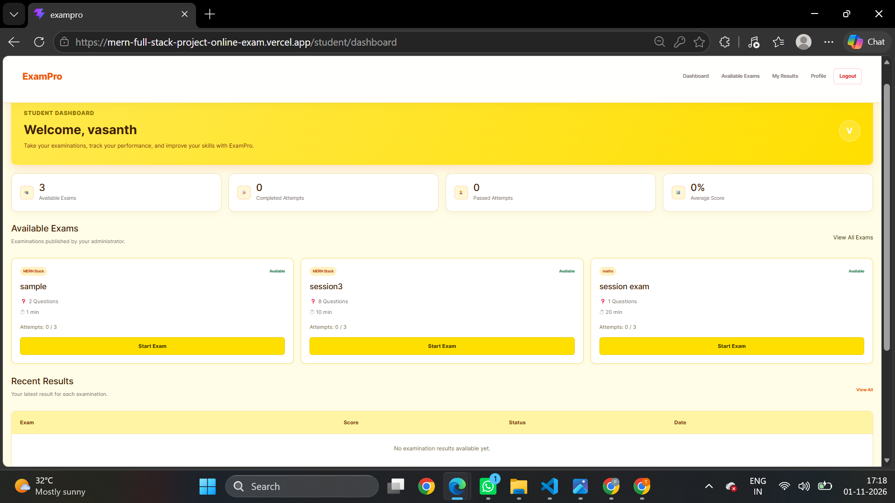

**Available Exams**

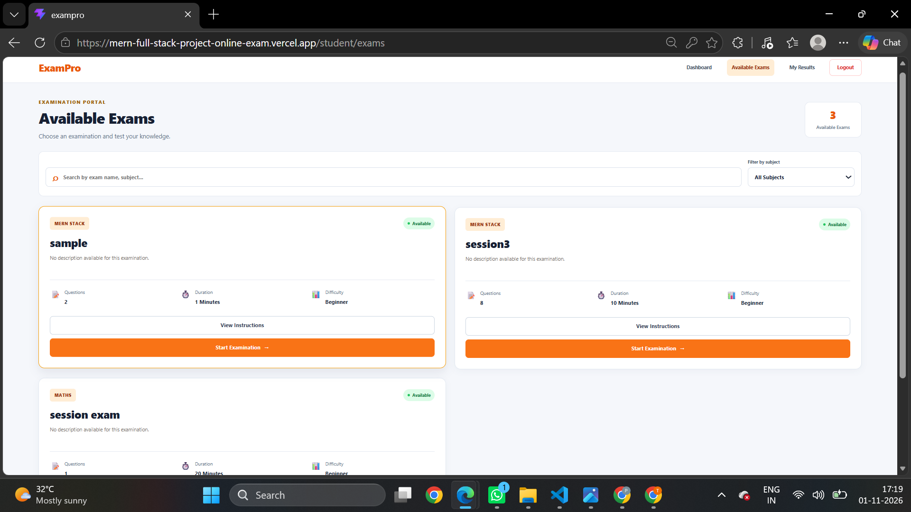

**My Results**

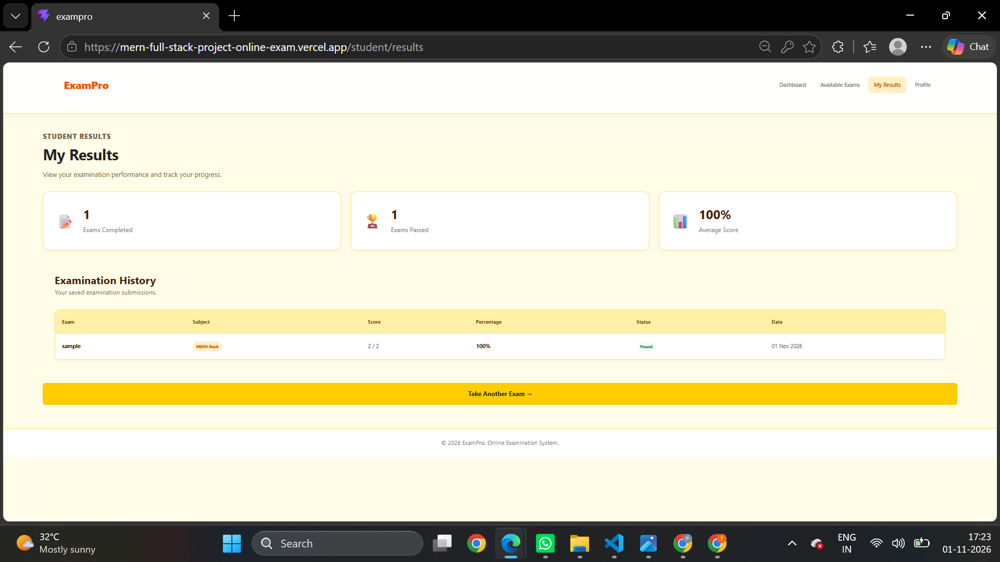

### Admin Side

**Admin Dashboard**

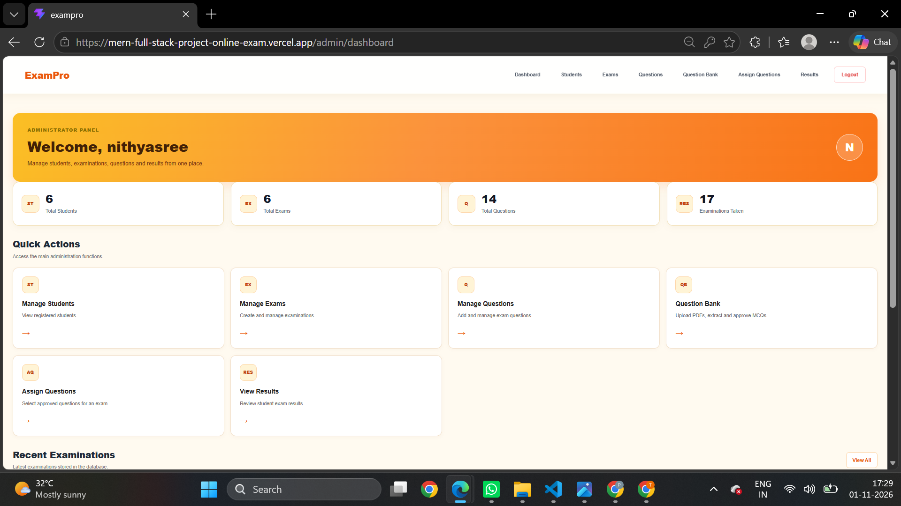

**Manage Exams**

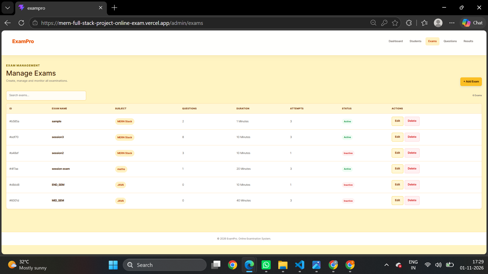

**Question Bank**

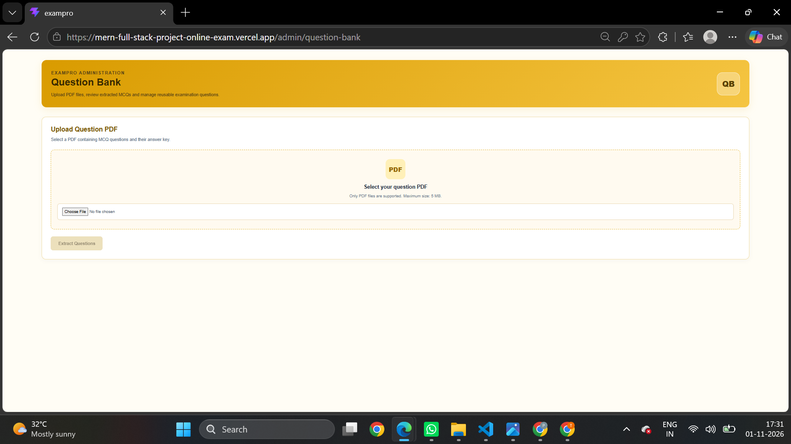

**Manage Questions**

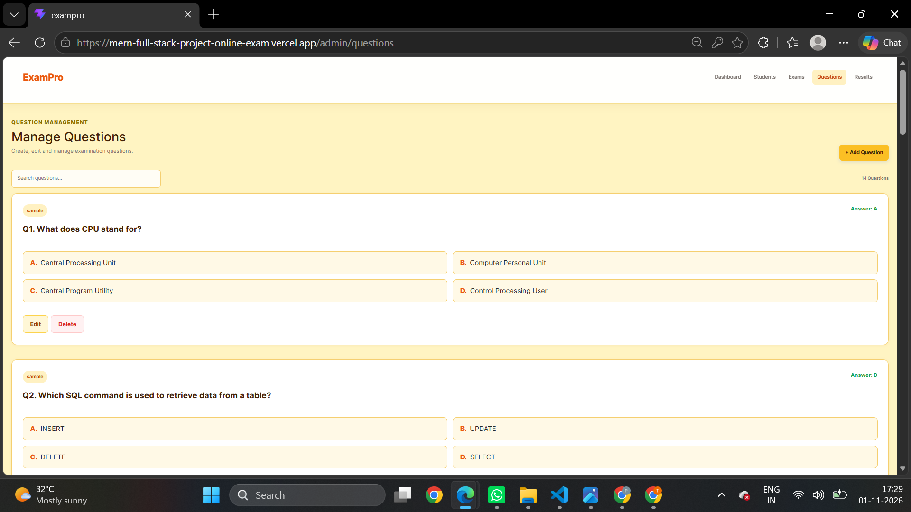

**Assign Questions**

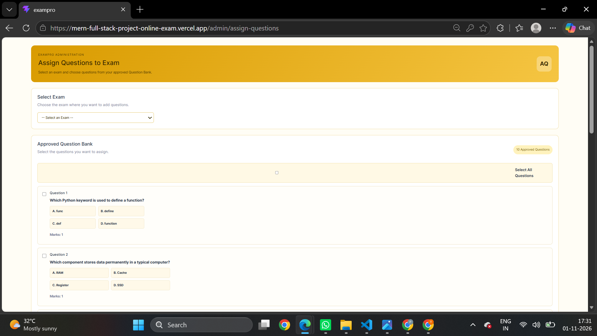

**Manage Students**

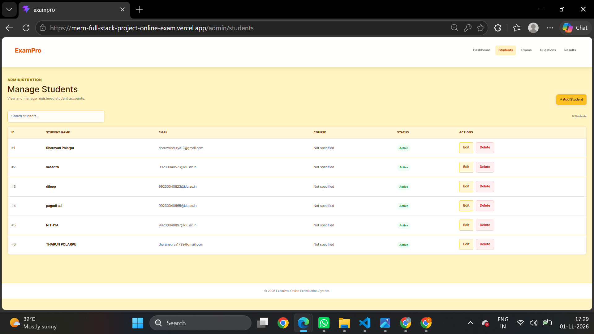

**View Results**

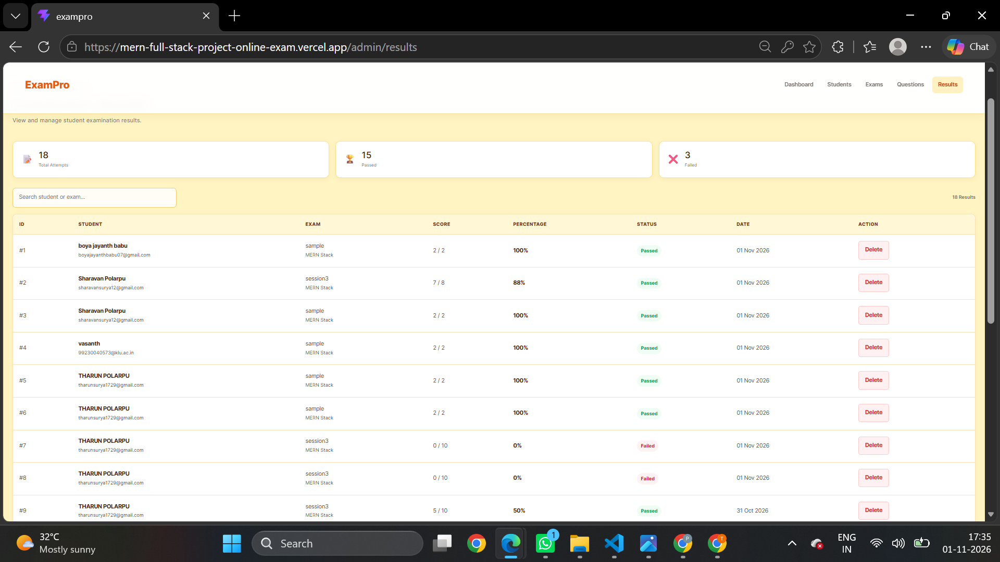

## Project Structure

```text
MernFullStack-project-online-examination-system/
│
├── Backend/
│   ├── config/
│   ├── controllers/
│   ├── middleware/
│   ├── models/
│   ├── routes/
│   └── server.js
│
├── src/
│   ├── assets/
│   ├── components/
│   ├── context/
│   ├── pages/
│   ├── App.jsx
│   └── main.jsx
│
├── public/
├── docs/
│   └── screenshots/
├── package.json
├── vite.config.js
└── README.md
```

## How to Run Locally

### 1. Clone the Repository

```bash
git clone https://github.com/polarputharun45/MernFullStack-project-online-examination-system.git
```

### 2. Install Frontend Dependencies

Run this command in the project root:

```bash
npm install
```

### 3. Install Backend Dependencies

```bash
cd Backend
npm install
```

### 4. Configure Environment Variables

Create a `.env` file inside the `Backend` folder.

Add the required variables:

```env
PORT=5000
MONGO_URI=your_mongodb_connection_string
JWT_SECRET=your_jwt_secret
EMAIL_USER=your_email
EMAIL_APP_PASSWORD=your_email_app_password
CLIENT_URL=http://localhost:5173
ADMIN_PASSWORD=your_admin_password
```

Replace the sample values with your own credentials. Do not upload your `.env` file or secret values to GitHub.

### 5. Start the Backend

Inside the Backend folder:

```bash
npm start
```

### 6. Start the Frontend

Open another terminal in the project root:

```bash
npm run dev
```

## Live Deployment

**Frontend:**  
https://mern-full-stack-project-online-exam.vercel.app

**Backend:**  
https://mernfullstack-project-online-examination.onrender.com

## Future Improvements

- Improve the examination interface.
- Add more result analysis features.
- Improve application performance.
- Add more features for students and administrators.

## Developed By

**SPIRIT**

MERN Stack Online Examination System
